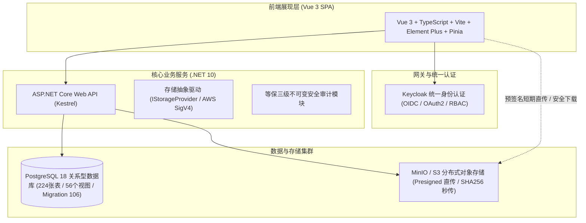

# Medical Research Management System (MRMS)
## 医疗与科研院所信创科研管理系统

[](https://dotnet.microsoft.com/)
[](https://vuejs.org/)
[](https://www.postgresql.org/)
[](https://min.io/)
[](https://www.keycloak.org/)
[](#)

---

### 一、系统简介

**MRMS（Medical Research Management System）** 是一套面向现代化综合性三甲医院、高等医学院校及科研院所设计的全流程信创科研管理系统。系统覆盖科研项目申报、评审立项、任务书签订、过程检查、经费入账与外拨执行、成果知识产权转化、科研平台与大型仪器共享、科研伦理审查及教育部科技统计等科研全生命周期。

系统底层完全自主可控，支持国产 CPU 架构（鲲鹏、飞腾、海光、兆芯、申威、LoongArch）、国产操作系统（麒麟 KylinOS、统信 UOS、OpenEuler）以及国产关系型数据库（人大金仓 KingbaseES、高斯 openGauss、达梦 DM8/DM9）。

---

### 二、系统技术架构



* **后端服务**：ASP.NET Core (.NET 10) Web API + Dapper + Npgsql，高并发行级锁安全编号生成；
* **前端工程**：Vue 3 + TypeScript + Vite 5 + Element Plus 2 + Pinia，响应式科研工作台；
* **数据存储**：PostgreSQL 18（共 106 个版本迁移脚本，包含完整业务约束与防篡改触发器）；
* **对象存储**：方案 B 工业级 S3 兼容对象存储驱动（MinIO / 华为云 OBS / 天翼云 OOS / 阿里云 OSS），支持前端安全预签名直传直取、SHA256 秒传去重、原中文文件名自动还原与等保三级不可变访问日志；
* **认证授权**：整合 Keycloak 26 集中式身份认证中心，支持多角色 RBAC 细粒度权限控制与授权代理。

---

### 三、主要业务模块与功能

1. **科研工作台与综合办公 (Office & Dashboard)**：角色化工作台、个人学术画像 (`ResearchPortfolio`)、通知公告、资料中心与网上服务；
2. **纵向项目管理 (Vertical Projects)**：申报指南、PDF 计划书智能解析批量导入、全生命周期推进（申报/立项/中检/变更/结题）；
3. **横向课题与产学研合同 (Horizontal Projects & Contracts)**：合同全生命周期签审、版本留痕与对比、合作单位资质审查、付款节点与收入认定；
4. **院级项目申报与专家评审 (Internal Projects & Expert Review)**：院内自主批次限额发布、专家库遴选与利益回避、双盲匿名在线打分；
5. **科研经费执行与全过程监管 (Finance & Budget)**：标准预算科目模板、银行流水认领拆卡、发票验真查重、外拨经费、跨年结转、工作量/绩效分割与结项结余；
6. **学术成果与知识产权管理 (Achievements & IP)**：论文成果全网推认领、JCR/中科院/CSSCI 分区自动对齐、专利生命周期与年费预警、软著/专著/报奖激励；
7. **科研平台与大型仪器开放共享 (Research Platforms & Instruments)**：重点实验室档案、仪器台账、时段排他悲观锁预约、机时计费与平台运行年报；
8. **学术活动与对外学术交流 (Academic Activities & Exchanges)**：主办会议审批与总结、外出参会申请、人员派出与接收进修管理；
9. **科研伦理审查与合规管理 (Ethics Review)**：医学人体伦理与动物伦理多类型审查、审查委员会指派与法定人数核验、匿名投票表决与批文归档；
10. **科研决策支持与统计上报 (Analytics & Ministry Statistics)**：教育部高等学校科技统计直报导出、全院科研多维穿透大屏、科室/个人当量考核；
11. **系统管理、等保与信创集成 (System & Governance)**：细粒度 RBAC 与字段权限、等保三级不可变审计、HIS/HRP/HR 接口适配器。

---

### 四、快速上手与本地运行

#### 1. 环境依赖
* Docker Desktop 24.0+ / Docker Compose V2
* 建议可用磁盘空间 >= 10GB，内存 >= 8GB

#### 2. 启动服务
```bash
# 1. 复制环境配置并设置强密码
cp .env.docker.example .env

# 2. 一键启动基础支撑与应用集群 (PostgreSQL, MinIO, Keycloak, App)
./deploy/start-local.sh
```

#### 3. 访问入口
* **科研管理系统主站**：[http://127.0.0.1:16379](http://127.0.0.1:16379)
* **MinIO S3 API**：`http://127.0.0.1:19000`
* **MinIO 控制台**：[http://127.0.0.1:19001](http://127.0.0.1:19001)（默认账号：`admin` / `ResearchAdmin2026!`）
* **Keycloak 统一认证**：[http://127.0.0.1:8180](http://127.0.0.1:8180)

---

### 五、发布门禁与自动化验证

系统内置严格的持续集成契约校验，在正式投产或发布前可执行：

```bash
# 运行 44 项静态与运行时全量发布门禁验证
./deploy/verify-local-release.sh

# 单独校验附件与对象存储驱动契约
./deploy/verify-attachment-storage-contract.sh
```
